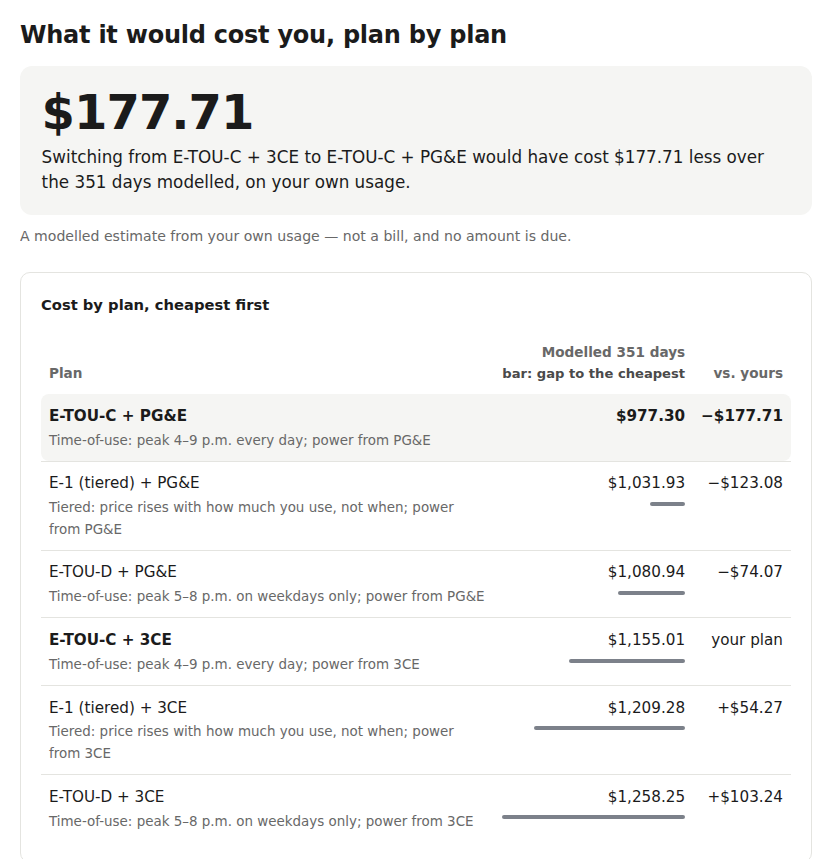

# Home Energy Advisor

Reproduces a household's real California utility bills from its own meter data, then re-bills
that usage under every plan it could be on to find the cheapest one.

[](https://github.com/CameronGordonn/energy-advisor/actions/workflows/ci.yml)
[](LICENSE)
[](environment.yml)

**[Try it with your own data](https://camerongordonn.github.io/energy-advisor/)** ·
**[Methodology](https://camerongordonn.github.io/energy-advisor/methodology.html)**

- **11 of 11** real PG&E statements reproduced within ±$2 from hourly meter data; the worst is
  off by **$0.22**.
- For the case-study household, the cheapest move is not a new rate schedule but leaving the
  community energy supplier (3CE) for PG&E generation: **$177.71** less over the 351 days of
  its own usage.
- On SDG&E, the published 2025, 2026 and current solar export-rate tables are byte-identical,
  so the nine-year rate lock-in installers cite as a reason to buy now is worth **$0** there.



*The site's worked example: the case-study household's plan ranking, as the browser tool shows
it.*

## What runs where

| | Browser ([site](https://camerongordonn.github.io/energy-advisor/)) | Command line |
|---|---|---|
| Read a PG&E or SDG&E Green Button file and show when the household uses power | Yes, for any file. The real Python parsers run in the page via WebAssembly, so the file never leaves your computer. | Yes |
| Rank every eligible rate plan in dollars (rate optimizer) | Only for households the tariff data describes: PG&E, baseline territory T, all-electric, with 3CE or PG&E as the generation supplier. Everyone else gets the load analysis and the specific reason no dollar figure is shown. The "worked example" button shows a precomputed ranking. | Yes, `scripts/rate_optimizer.py` |
| Solar and battery payback under NEM 3.0 | No | Yes, `scripts/nem3_report.py`. Runs end to end, but on an illustrative synthetic load until a real solar household's data is available. |
| Line-by-line comparison against real bills | No | Yes, `scripts/reconcile_report.py`. Needs the household's own data in `data/`. |

## Bill-reconciliation accuracy

Every dollar figure downstream is only as good as the bill engine's ability to reproduce
**real** utility bills from **real** interval data. Target: **±$2/month** vs. the actual bill.
This table is regenerated from the golden-bill regression suite.

<!-- RECONCILIATION-TABLE:START -->
| Utility | Schedule | Bill period | Actual $ | Modeled $ | Δ $ | Within ±$2 |
|---------|----------|-------------|---------:|----------:|----:|:----------:|
| PG&E | E-TOU-C + 3CE | 2025-08-02 → 2025-08-25 | 70.57 | 70.73 | +0.16 | ✅ |
| PG&E | E-TOU-C + 3CE | 2025-08-26 → 2025-09-24 | 107.52 | 107.74 | +0.22 | ✅ |
| PG&E | E-TOU-C + 3CE | 2025-09-25 → 2025-10-26 | 49.11 | 49.32 | +0.21 | ✅ |
| PG&E | E-TOU-C + 3CE | 2025-10-27 → 2025-11-24 | 82.08 | 82.10 | +0.02 | ✅ |
| PG&E | E-TOU-C + 3CE | 2025-11-25 → 2025-12-26 | 73.77 | 73.87 | +0.10 | ✅ |
| PG&E | E-TOU-C + 3CE | 2025-12-27 → 2026-01-27 | 156.88 | 157.09 | +0.21 | ✅ |
| PG&E | E-TOU-C + 3CE | 2026-01-28 → 2026-02-26 | 168.75 | 168.93 | +0.18 | ✅ |
| PG&E | E-TOU-C + 3CE | 2026-02-27 → 2026-03-29 | 93.86 | 93.97 | +0.11 | ✅ |
| PG&E | E-TOU-C + 3CE | 2026-03-30 → 2026-04-27 | 90.05 | 90.12 | +0.07 | ✅ |
| PG&E | E-TOU-C + 3CE | 2026-04-28 → 2026-05-27 | 112.20 | 112.32 | +0.12 | ✅ |
| PG&E | E-TOU-C + 3CE | 2026-05-28 → 2026-06-25 | 79.47 | 79.62 | +0.15 | ✅ |
<!-- RECONCILIATION-TABLE:END -->

> No feature that produces a dollar figure ships until the row(s) above are green.

**[Read the methodology and case study](docs/METHODOLOGY.md):** how the engine computes a
bill, what the residual above is made of, one household worked end to end, and a full list of
what is still assumed or unverified. The same writeup as a standalone page, with the residual
chart, is [docs/methodology.html](docs/methodology.html), served at
[camerongordonn.github.io/energy-advisor/methodology.html](https://camerongordonn.github.io/energy-advisor/methodology.html).

## Status

Milestones are defined in [ROADMAP.md](ROADMAP.md); a milestone counts as done only when
its definition of done is *demonstrated*, not merely implemented. Design rules are in
[CLAUDE.md](CLAUDE.md).

| Milestone | State |
|---|---|
| **M0**: PG&E bill reconciliation | **Done.** All 11 real statements reproduced within ±$2 (worst +$0.22), from the household's own hourly interval data. The table above is the artifact. |
| **M1**: SDG&E engine + CCA overlay | **Engine built, blocked on data.** SDG&E TOU-DR1 / TOU-DR2 / EV-TOU-5 delivery specs, the TOU-DR1 bundled generation layer, climate-zone baseline allowances and the non-bypassable charges all ship, and re-sum to SDG&E's own published total rates on every cell. Done means reproducing real SDG&E statements, and none are available yet. |
| **M2**: Rate optimizer | **Done on the PG&E household.** One command ranks every eligible schedule with the community supplier on or off, and reports the annual difference, a component-level explanation, a sensitivity note and an assumption audit. |
| **M3**: NEM 3.0 solar + battery | **Engine complete, blocked on data.** Per-vintage export-rate tables with the nine-year lock-in, Net Billing Tariff settlement, the non-bypassable import floor, PVWatts production, greedy *and* LP battery dispatch, payback, and Monte Carlo ranges. Done needs one real household with solar export data; a synthetic load is not a substitute. |
| **M4**: Public methodology + case study | **Done.** [docs/METHODOLOGY.md](docs/METHODOLOGY.md) and the [live page](https://camerongordonn.github.io/energy-advisor/methodology.html). The case study is my own household, so it carries my name rather than being anonymized. |
| **M5**: First external users | Not started. |

One more finding generic calculators miss: on Schedule EV-TOU-5 roughly 45% of the
super-off-peak delivery charge is non-bypassable (against about 6.5% in other windows),
because the schedule discounts distribution but not the non-bypassable charges.

## Development

```bash
conda env create -f environment.yml   # first time
conda activate energy-advisor
pytest                                 # the test suite
ruff check . && ruff format --check .  # lint / format
```

The suite has 1,831 tests. With the household's data present all 1,831 pass (2026-10-23). On a
clean clone, and in [CI](.github/workflows/ci.yml), the 37 golden-bill tests skip because the
interval data is never committed, and the other 1,794 pass. CI also checks that the browser
bundle matches `src/` and renders the tool.

Reports (each needs `PYTHONPATH=src`, since only pytest picks up `src/` automatically):

```bash
PYTHONPATH=src python scripts/reconcile_report.py   # line-item bill comparison
PYTHONPATH=src python scripts/rate_optimizer.py     # rate ranking, sensitivity, assumption audit
PYTHONPATH=src python scripts/nem3_report.py        # solar + battery under the Net Billing Tariff
```

Package layout lives under `src/` (`greenbutton`, `tariffs`, `nem3`, `scenarios`,
`uncertainty`, `report`). Real Green Button exports and bills live in `data/` and
`tests/golden_bills/raw/`, both git-ignored, so nothing personally identifiable is ever
committed. Development notes from building it are in [`dev/`](dev/).

## License

Copyright © 2026 Cameron Gordon. Licensed under the
**[GNU Affero General Public License v3.0](LICENSE)**.

AGPL rather than MIT deliberately: the tariff engine is the substance of this project, and
the AGPL's network clause means anyone who runs a modified version as a hosted service has
to publish their source. Reading, learning from, running and contributing to it are all
unrestricted.

Tariff rates, Avoided Cost Calculator tables and utility tariff sheets referenced here are
public regulatory filings and are not covered by this license. Each is cited in the spec
file that uses it. **Nothing here is financial advice**; it is analysis of published tariffs
against a household's own metered data.
